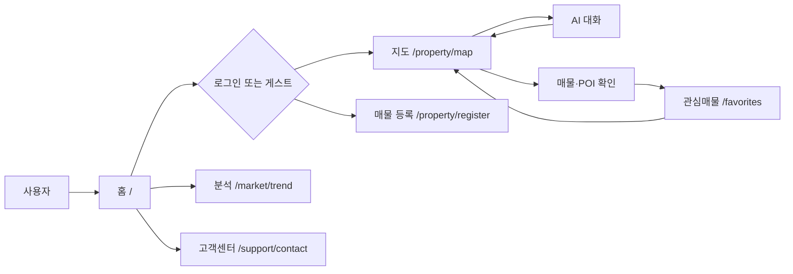
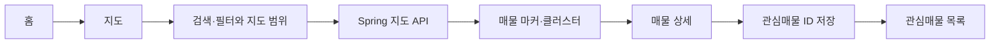
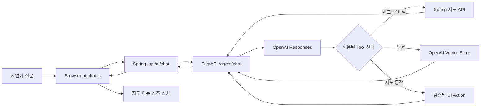
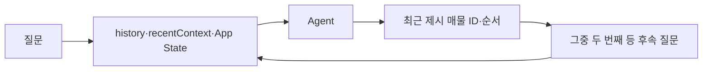
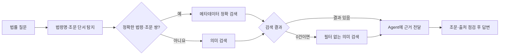
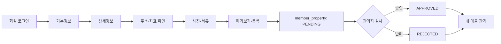

# 1. 플로 차트

[프로젝트 문서 홈](README.md) · [이전: 문서 홈](README.md) · [다음: 프로젝트 기획서](02_project_plan.md) · [Repository README](../../README.md)

다이어그램은 현재 코드의 화면과 요청 경로를 보여 줍니다. 외부 서비스의 실시간 가용 여부는 별도 확인 대상입니다.

## A. 전체 서비스 사용자 흐름

홈에서 시작한 질문은 `sessionStorage`를 통해 지도 채팅 입력으로 전달됩니다. 근거: [main.js](../../src/main/resources/static/js/main.js), [ai-chat.js](../../src/main/resources/static/js/ai-chat.js), [PageController.java](../../src/main/java/com/onrender/zipchatgo/controller/PageController.java).

## B. 지도 탐색

지도 API는 DB 오류 시 정적 JSON으로 전환할 수 있습니다. 관심매물 ID의 저장 위치는 브라우저 `sessionStorage`입니다. 근거: [map.js](../../src/main/resources/static/js/map.js), [MapDataController.java](../../src/main/java/com/onrender/zipchatgo/map/MapDataController.java), [favorite.js](../../src/main/resources/static/js/favorite.js).

## C. AI Agent와 UI Action

Action은 정해진 종류와 인자만 브라우저가 실행합니다. AI가 임의 JavaScript를 실행하지 않습니다. 근거: [AiService.java](../../src/main/java/com/onrender/zipchatgo/ai/AiService.java), [main.py](../../ai-server/app/main.py), [openai_provider.py](../../ai-server/app/providers/openai_provider.py), [map.js](../../src/main/resources/static/js/map.js).

## D. 후속 대화

`history`와 `recentContext`는 페이지 메모리에서 관리되며 요청마다 다시 전달됩니다. 브라우저 새로고침 뒤 원문 대화를 DB에서 복원하는 경로는 확인되지 않습니다. 근거: [ai-chat.js](../../src/main/resources/static/js/ai-chat.js), [schemas.py](../../ai-server/app/schemas.py).

## E. 법률 RAG

운영 검색과 답변 점검은 [real_estate_law.py](../../ai-server/app/tools/real_estate_law.py), [openai_vector_store_law_retriever.py](../../ai-server/app/retrievers/openai_vector_store_law_retriever.py), [openai_provider.py](../../ai-server/app/providers/openai_provider.py)에 있습니다. 평가 전용 validator는 운영 응답의 별도 hard gate로 확인되지 않습니다.

## F. 매물 등록과 심사

**등록·승인은 지도 `properties` 자동 반영을 뜻하지 않습니다.** 두 데이터 경로를 연결하는 자동 동기화 코드는 확인되지 않았습니다. 근거: [register.js](../../src/main/resources/static/js/register.js), [MemberPropertyService.java](../../src/main/java/com/onrender/zipchatgo/property/MemberPropertyService.java), [AdminPropertyController.java](../../src/main/java/com/onrender/zipchatgo/property/AdminPropertyController.java), [MapDataService.java](../../src/main/java/com/onrender/zipchatgo/map/MapDataService.java).

---

[프로젝트 문서 홈](README.md) · [이전: 문서 홈](README.md) · [다음: 프로젝트 기획서](02_project_plan.md) · [Repository README](../../README.md)
