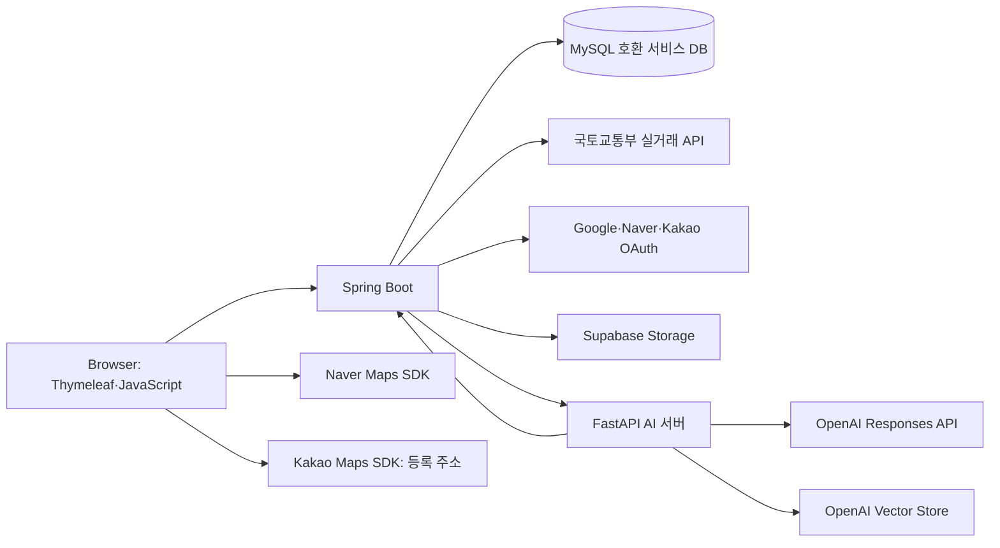
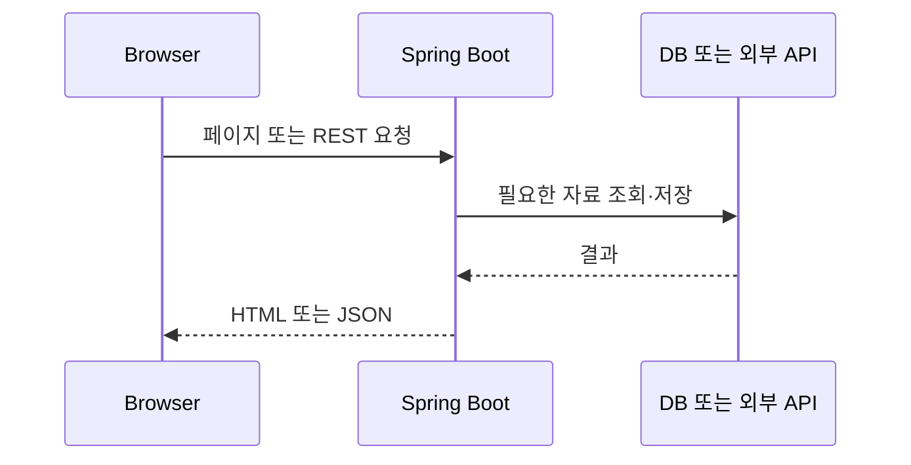
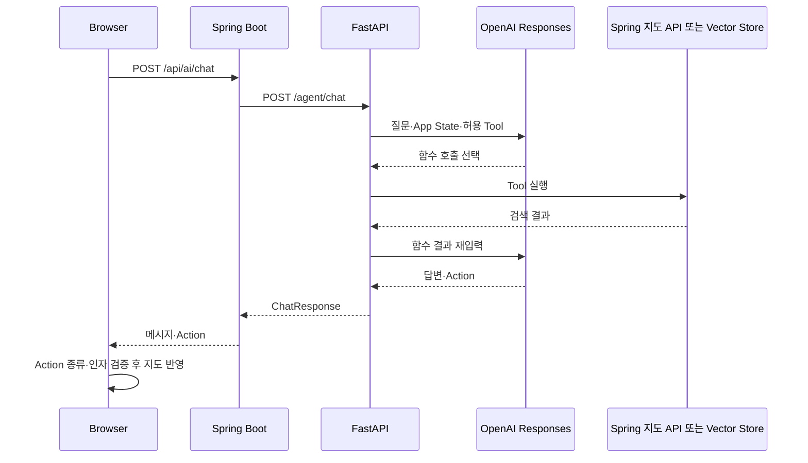
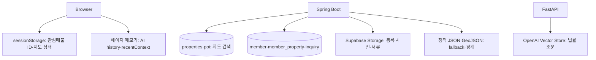

# 5. 시스템 아키텍처 설계서

[프로젝트 문서 홈](README.md) · [이전: 프로세스 정의서](04_process_definition.md) · [다음: 화면 설계서](06_screen_design.md) · [Repository README](../../README.md)

## 1. 전체 시스템

일반 데이터·인증·등록은 Spring이 처리합니다. FastAPI는 AI 전용 서버이며 매물·POI 조회가 필요하면 Spring의 명시적 API를 다시 호출합니다. 법령 수집용 국가법령정보센터 API는 사전 자료 구축 경로에 있으며 일반 채팅 요청마다 호출하지 않습니다. 근거: [AiService.java](../../src/main/java/com/onrender/zipchatgo/ai/AiService.java), [main.py](../../ai-server/app/main.py), [national_law_api.py](../../ai-server/app/law/national_law_api.py), [docker-compose.yml](../../docker-compose.yml).

## 2. 일반 요청

지도는 [MapDataController.java](../../src/main/java/com/onrender/zipchatgo/map/MapDataController.java), 시장 요약은 [MarketApiController.java](../../src/main/java/com/onrender/zipchatgo/market/MarketApiController.java), 회원 등록 매물은 [PropertyController.java](../../src/main/java/com/onrender/zipchatgo/property/PropertyController.java)가 대표 진입점입니다.

## 3. AI 요청과 Tool

`POST /agent/chat`은 내부 API 키를 검사합니다. Provider는 OpenAI Responses 호출에 `store=False`를 사용합니다. Tool 선택은 최대 반복 한도가 있고, 브라우저는 허용된 Action만 처리합니다. 법률 검색은 Store의 근거를 재주입한 뒤 조문·링크를 점검하지만 모든 법적 주장을 완전히 검증하지는 않습니다. 근거: [main.py](../../ai-server/app/main.py), [openai_provider.py](../../ai-server/app/providers/openai_provider.py), [map.js](../../src/main/resources/static/js/map.js).

## 4. 데이터 저장 구조

| 저장 위치 | 자료와 역할 | 중요한 경계 |
|---|---|---|
| `properties`, `poi` | 지도 매물·시설과 거래 조회 | Spring `MapDataService`가 읽음. DB 실패 시 정적 자료 fallback 가능 |
| `member`, `member_property`, `inquiry` 등 | 회원·회원 등록 매물·문의 | `member_property` 승인 후 지도 `properties` 자동 동기화는 확인되지 않음 |
| 브라우저 `sessionStorage` | 관심매물 ID, 지도 viewport, 홈에서 넘긴 질문 | 계정별 영구 보관이나 다중 기기 동기화가 아님 |
| 브라우저 페이지 메모리 | AI history, recentContext | 새로고침 뒤 원문 복원 DB 코드 확인되지 않음 |
| Supabase Storage | 등록 사진·서류의 실제 파일 | DB에는 파일 경로·메타데이터 저장 |
| 정적 JSON·GeoJSON | 지도 DB fallback, 역·법정동·학군 경계 | 데이터 원천·갱신 시점은 항목별 확인 필요 |
| OpenAI Vector Store | 사전 구축한 법률 조문 문서 | 서비스 DB의 `law` 테이블과 구분. 현재 운영 Store 내용은 확인 필요 |

근거: [MapDataService.java](../../src/main/java/com/onrender/zipchatgo/map/MapDataService.java), [MemberProperty.java](../../src/main/java/com/onrender/zipchatgo/property/MemberProperty.java), [favorite.js](../../src/main/resources/static/js/favorite.js), [ai-chat.js](../../src/main/resources/static/js/ai-chat.js), [SupabaseStorageService.java](../../src/main/java/com/onrender/zipchatgo/property/SupabaseStorageService.java), [openai_vector_store_law_retriever.py](../../ai-server/app/retrievers/openai_vector_store_law_retriever.py).

## 5. 기술 스택과 책임

| 영역 | 기술 | 책임 |
|---|---|---|
| Frontend | Thymeleaf, HTML/CSS/JavaScript, Naver Maps, 클러스터 | 화면·지도·허용 Action 실행 |
| 주소 확인 | Kakao Maps SDK | 등록 화면 주소 검색·좌표 확인 |
| Backend | Spring Boot, Spring Security, HttpSession, JDBC·JdbcTemplate | 페이지·인증·데이터·비즈니스 로직 |
| AI | FastAPI, Pydantic, OpenAI Responses Tool Calling | 대화 문맥·Tool 선택·응답·Action 구조화 |
| 법률 검색 | OpenAI Vector Store | 조문 검색과 근거 전달 |
| 파일 | Supabase Storage | 등록 사진·서류 파일 보관 |
| 배포 설정 | Docker, Docker Compose, EC2 workflow, Render 설정 | 빌드·서비스 기동 정의. 현재 운영 상태는 확인 필요 |

DB 연결 설정은 MySQL JDBC 형식입니다. 현재 운영 DB 제품·호스팅 상태는 코드만으로 단정하지 않습니다. 시장 요약은 [MarketService.java](../../src/main/java/com/onrender/zipchatgo/market/MarketService.java)가 국토교통부 아파트 매매·전월세 API를 호출하거나 키가 없을 때 demo를 반환합니다. 차트 전부가 실측 월별 시계열인 것은 아닙니다.

## 6. 보안·설계 원칙

| 항목 | 현재 코드에서 확인한 처리 |
|---|---|
| 내부 통신 | Spring→FastAPI에 `INTERNAL_API_KEY` 헤더 사용. [AiClientConfig.java](../../src/main/java/com/onrender/zipchatgo/ai/AiClientConfig.java), [main.py](../../ai-server/app/main.py) |
| 회원·관리자 | 세션 ID와 인터셉터, Spring Security OAuth2 설정. [AuthInterceptor.java](../../src/main/java/com/onrender/zipchatgo/config/AuthInterceptor.java), [AdminInterceptor.java](../../src/main/java/com/onrender/zipchatgo/config/AdminInterceptor.java) |
| 비밀번호 | 회원 서비스의 BCrypt 처리. [MemberService.java](../../src/main/java/com/onrender/zipchatgo/member/MemberService.java) |
| 입력·Action | Spring 요청 검증, Pydantic schema, 브라우저 Action 종류·인자 검사. [schemas.py](../../ai-server/app/schemas.py), [map.js](../../src/main/resources/static/js/map.js) |
| 비밀값 | 환경변수 이름으로 주입. 실제 값은 문서·Git에 포함하지 않음. [application.properties](../../src/main/resources/application.properties), [config.py](../../ai-server/app/config.py) |
| 모델 저장 | Responses 요청에 `store=False`. 서비스 DB의 대화 원문 저장 경로 확인되지 않음. [openai_provider.py](../../ai-server/app/providers/openai_provider.py) |

## 7. 배포 설정과 확인 범위

[docker-compose.yml](../../docker-compose.yml)은 Spring `8080`을 외부 공개하고 FastAPI `8000`을 내부 서비스로 둡니다. [EC2 workflow](../../.github/workflows/deploy-ec2.yml)는 지정 브랜치 push 시 self-hosted runner에서 fetch·fast-forward pull·Compose build/up을 수행하도록 정의돼 있습니다. [render.yaml](../../render.yaml)도 별도 서비스 설정입니다. **이 파일들의 존재는 실제 운영 URL·이미지 버전·환경변수·가용성을 증명하지 않습니다.** 운영 현황은 별도 확인이 필요합니다.

---

[프로젝트 문서 홈](README.md) · [이전: 프로세스 정의서](04_process_definition.md) · [다음: 화면 설계서](06_screen_design.md) · [Repository README](../../README.md)
